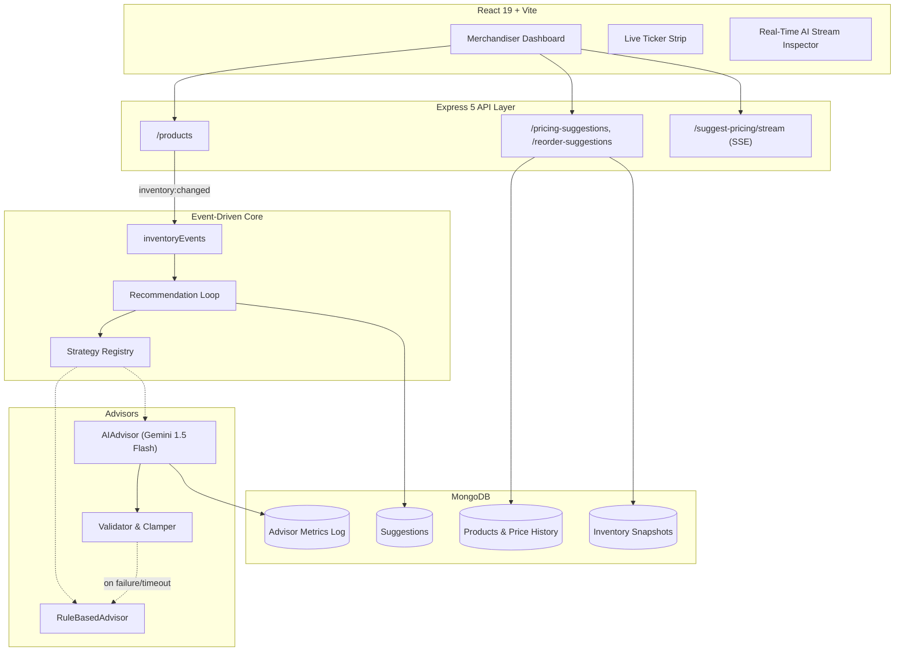

# Sentinel

**An event-driven inventory and dynamic pricing engine that treats AI as advisory, not authoritative.**

Sentinel is a full-stack commerce decision system that autonomously detects inventory and demand signals, generates pricing and replenishment recommendations using either deterministic rules or a Gemini 1.5 Flash LLM advisor, and routes every suggestion through a human-in-the-loop approval queue before it can affect live pricing or stock.

---

## Why this exists

Most autonomous pricing/inventory tools force a choice between rigid manual spreadsheets and opaque AI systems that can make unbounded, unexplained decisions. Sentinel is built around a different premise: **AI-generated commerce decisions should be fast to produce but slow to trust.** Every AI suggestion is bounded, validated, logged, and reviewable — and if the AI fails or drifts outside safe limits, the system falls back to deterministic logic without dropping the request.

This project was built to test that premise empirically, not just claim it. See [Validation Results](#validation-results) below.

---

## Architecture



---

## Core Design Decisions

| Decision | Implementation | Why |
|---|---|---|
| Decouple commerce logic from HTTP/models | `CommerceAdvisor` base class; `RuleBasedAdvisor` and `AIAdvisor` resolved via a strategy registry | Swap engines at runtime with zero downtime |
| Treat LLM output as untrusted | 10s timeout, JSON schema validation, price clamped to 0.5x–3.0x, automatic fallback on any violation | AI failures degrade gracefully instead of corrupting live pricing |
| Human-in-the-loop checkpoint | All suggestions start `PENDING`; only human approval mutates price/stock | Prevents unreviewed AI decisions from reaching customers |
| Idempotent, concurrency-safe processing | In-flight locks per product/trigger prevent duplicate suggestions during concurrent events | Protects against duplicate-advice storms during traffic spikes |
| Immutable audit trail | Every stock change logged to `InventorySnapshot` with source and timestamp | Full traceability of what changed, when, and why |

---

## Tech Stack

**Backend:** Node.js, Express 5, MongoDB + Mongoose, Google Gemini 1.5 Flash API
**Frontend:** React 19, Vite, custom CSS design system
**Testing:** Fault-injection harness, concurrency load harness, benchmark evaluation harness

---

## Validation Results

Architectural claims (ADRs) were validated empirically rather than assumed. Full methodology and raw numbers in [`RESULTS.md`](./RESULTS.md).

| Test | Claim | Result |
|---|---|---|
| Fault injection (18 scenarios: malformed JSON, out-of-bounds prices, timeouts, network failure) | AI failures always fall back safely | **18/18 (100%) safe fallback, 0 suggestions dropped** |
| Concurrency (100 simultaneous events) | No duplicate suggestions under concurrent load | **0 duplicates detected** |
| Rate-limit resilience (simulated Gemini 429s) | Suggestions retained despite upstream throttling | **68/68 (100%) retained via fallback** |
| Advisor benchmark (25 labeled scenarios) | Compare rule-based vs. AI advisor against expected decisions | Rule-based: **100% directional agreement, 99.6% price proximity.** AI advisor: **96% directional agreement, 97.4% price proximity** |

**Honest takeaway:** the rule-based advisor matched expected decisions more closely than the LLM advisor in this benchmark. That result reinforces the core design choice — the AI is a fast, exploratory suggestion generator, not a trusted decision-maker, which is exactly why every AI output is bounded and reviewable rather than applied directly.

---

## API Reference

| Method | Endpoint | Description |
|---|---|---|
| `GET` | `/products` | List catalog items (`?status=&category=`) |
| `PATCH` | `/products/:id/stock` | Adjust inventory (`{ stockLevel }` or `{ delta }`) |
| `POST` | `/products/:id/orders` | Simulate a purchase |
| `POST` | `/products/:id/suggest-pricing` | Generate pricing advice on demand |
| `POST` | `/products/:id/suggest-pricing/stream` | Stream live Gemini reasoning (SSE) |
| `POST` | `/products/:id/suggest-reorder` | Generate reorder advice on demand |
| `GET` / `PATCH` | `/pricing-suggestions[/:id]` | Fetch or accept/reject pricing suggestions |
| `GET` / `PATCH` | `/reorder-suggestions[/:id]` | Fetch or accept/reject reorder suggestions |
| `GET` / `PATCH` | `/config/strategy` | View or change the active advisor strategy |

---

## Getting Started

### Prerequisites
- Node.js 18+
- MongoDB running locally (`mongodb://localhost:27017`)
- Gemini API key (optional — system falls back to rule-based advisor if absent)

### Backend
```bash
cd backend
cp .env.example .env      # add your MONGO_URI and LLM_API_KEY
npm install
node seed.js               # seed catalog + snapshots
npm run dev                 # http://localhost:5000
```

### Frontend
```bash
cd frontend
npm install
npm run dev                 # http://localhost:5173
```

### Running Tests
```bash
cd backend
npm test               # fault injection + concurrency (fast)
npm run test:fault     # 18-case fault injection battery
npm run test:concurrency  # 100 concurrent events
npm run test:benchmark    # 25-scenario rule vs. AI evaluation
npm run test:load         # 520-product scale test
npm run test:all          # complete suite
```

---

## Roadmap

- Competitor-aware pricing strategy via the existing registry extension seam
- ARIMA/LSTM-based demand velocity forecasting to replace the 24h moving average
- Historical `InventorySnapshot` timeline visualizations
- Expand the benchmark evaluation set beyond 25 scenarios for tighter confidence intervals

---

## License

MIT