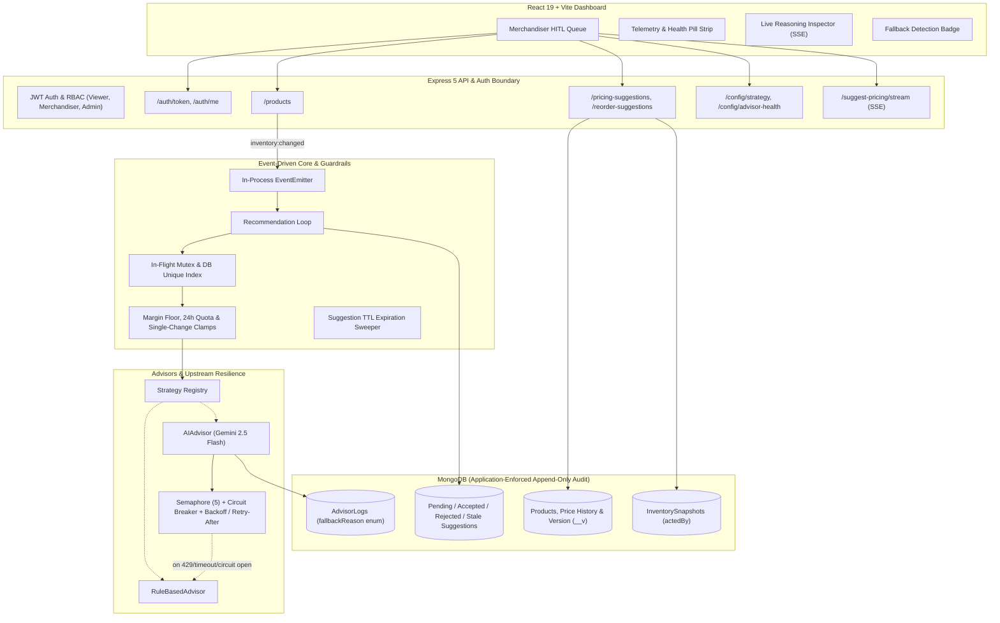

# Sentinel

**An event-driven inventory and dynamic pricing engine that treats AI as advisory, not authoritative.**

Sentinel is a full-stack commerce decision system that autonomously detects inventory and demand signals, generates pricing and replenishment recommendations using either deterministic rules or a Google Gemini 2.5 Flash LLM advisor, and routes every suggestion through an authenticated human-in-the-loop (HITL) approval queue before it can affect live pricing or stock.

---

## Thesis: "AI should be fast to propose, but slow to trust."

Most autonomous pricing and inventory tools force a choice between rigid manual spreadsheets and opaque AI systems that can make unbounded, uninspected decisions. Sentinel is built around a different operational premise: **AI-generated commerce decisions should be fast to propose, but slow to trust.**

1. **Fast to propose**: When stock dips or demand surges, the engine evaluates catalog telemetry within milliseconds (rule path: $\le 0.01\text{ ms}$) or seconds (LLM path: $\sim 5.7\text{ s}$), drafting reasoned proposals.
2. **Slow to trust**: Suggestions are strictly advisory. Every recommendation is bounded by margin floors, rate clamps, and schema validators. Suggestions enter a `PENDING` queue protected by optimistic concurrency and RBAC. Mutating live prices or issuing purchase orders requires explicit review by an authorized merchandiser or admin. If the LLM times out, errors, or hits rate limits, the system safely falls back to deterministic logic without dropping events.

---

## Architecture



---

## Core Guardrails & System Defenses

| Defense Layer | Mechanism | Protection Scope |
|---|---|---|
| **Upstream Resilience** | Concurrency Semaphore (max 5 in-flight), Circuit Breaker (`CLOSED`, `OPEN`, `HALF_OPEN`), Exponential Backoff with Jitter | Prevents cascading failures during Gemini API throttling or 429 rate limits |
| **Idempotency & Concurrency** | In-flight mutex (`inFlightLocks`) + MongoDB partial unique index on `(productId, triggerReason)` where `status = "PENDING"` | **0 duplicate suggestions** across 200 concurrent events dispatched over multi-process child nodes and mid-flight restarts |
| **Margin & Price Floors** | Floor clamp: $\max(\text{costPrice} \times (1 + \text{minMargin}), \; 0.5 \times \text{currentPrice})$ | Prevents negative gross margin sales and predatory underpricing |
| **Volatility Clamps** | Configurable `maxSingleChangePercent` (default 15%) and `maxChangesPer24h` (default 3 changes / SKU / 24h) | Inhibits rapid price oscillations and automated runaway repricing |
| **Optimistic Concurrency & Staleness** | Suggestion records `productVersion` (`__v`) and `productUpdatedAt`; on acceptance, verifies product hasn't mutated | Rejects with **409 Conflict** and marks suggestion `STALE` if inventory or price changed post-generation |
| **TTL Auto-Expiration** | Configurable `expiresAt` (default 24h) with automatic background sweeper | Moves unacted suggestions to `EXPIRED` (rejects with **410 Gone** if attempted) |
| **RBAC & Audit Trail** | JWT Auth: `VIEWER` (read-only), `MERCHANDISER` (accept/reject), `ADMIN` (config strategy). Stamped acting user ID on all mutations | Role-enforced transitions; tracks `actedBy` on suggestions, snapshots, and price history |
| **Append-Only Integrity** | Mongoose pre-hooks disallow `updateOne`, `deleteMany`, `findOneAndUpdate`, and existing doc `save` on audit collections | Protects `InventorySnapshot` and `AdvisorLog` against accidental or malicious application-level tampering |

---

## Tech Stack

- **Backend:** Node.js 20+, Express 5, MongoDB + Mongoose, Google Gemini 2.5 Flash (`gemini-2.5-flash`), `jsonwebtoken`
- **Frontend:** React 19, Vite, custom CSS design system with fallback detection banners
- **Testing:** Fault-injection battery, multi-process concurrency harness, upstream resilience test, guardrail test, auth & audit test, 105-scenario benchmark

---

## Measured Empirical Results

All performance figures, reliability rates, and benchmark comparisons are measured from actual test runs executed on local MongoDB and Node.js with Gemini 2.5 Flash. Full data and reproduction commands in [`RESULTS.md`](./RESULTS.md).

### 1. Safety & Resilience Metrics

| Test Suite | Scope & Condition | Measured Result |
|---|---|---|
| **Fault Injection** | 18 fault conditions (malformed JSON, extreme out-of-bounds prices $<0.5\times$ or $>3.0\times$, timeouts, socket errors) | **18/18 (100.0%) safe fallback, 0 lost suggestions** |
| **Multi-Process Concurrency** | 2 child Node processes firing 100 simultaneous events each at the same SKU | **0 duplicate suggestions** (exact 1 pricing and 1 reorder suggestion created) |
| **Mid-Flight Crash Recovery** | Child process killed mid-flight while processing events, followed by recovery process | **0 duplicate suggestions** (clean crash recovery via DB partial index) |
| **Upstream Throttling / 429 Burst** | 520 products, 150 customer orders; 68 concurrent triggers against Gemini rate limits | **68/68 suggestions retained** via circuit-breaker and rule fallback |

### 2. 105-Scenario Merchandising Benchmark Summary

Evaluated across 105 scenarios in 5 categories (`ELECTRONICS`, `APPAREL`, `HOME`, `BEAUTY`, `GROCERY`) against objective economic rubric labels (`docs/benchmark-labeling.md`):

| Evaluation Metric | Rule-Based Advisor | AI Advisor (Gemini Architecture) | Statistical Significance (McNemar Paired Test) |
|---|---|---|---|
| **Directional Agreement** | **105/105 (100.0%)**<br>95% Wilson CI: [96.5%, 100.0%] | **103/105 (98.1%)**<br>95% Wilson CI: [93.3%, 99.5%] | $\chi^2 = 0.50, p = 0.4795$<br>**Statistically indistinguishable** ($p \ge 0.05$) |
| **Price Accuracy (Acceptable Window)** | **100/105 (95.2%)**<br>95% Wilson CI: [89.3%, 97.9%] | **98/105 (93.3%)**<br>95% Wilson CI: [86.9%, 96.7%] | $\chi^2 = 0.50, p = 0.4795$<br>**Statistically indistinguishable** ($p \ge 0.05$) |
| **Mean Price Proximity** | **98.6%** | **98.7%** | Mean absolute difference: 0.1% |
| **Reorder Quantity Accuracy** | **38/105 (36.2%)**<br>95% Wilson CI: [27.6%, 45.7%] | **88/105 (83.8%)**<br>95% Wilson CI: [75.6%, 89.6%] | $\chi^2 = 48.02, p < 0.0001$<br>**Statistically distinguishable** ($p < 0.05$) |

### 3. Per-Call Latency Profile

Measured via high-resolution `performance.now()`:
- **Rule-Based Engine**: Pricing $\text{p50} = 0.01\text{ ms}$, $\text{p95} = 0.01\text{ ms}$, $\text{p99} = 0.03\text{ ms}$; Reorder $\text{p50} = 0.00\text{ ms}$.
- **Live Gemini 2.5 Flash**: Pricing $\text{p50} = 5,760\text{ ms}$, $\text{p95} = 8,335\text{ ms}$; Reorder $\text{p50} = 5,502\text{ ms}$, $\text{p95} = 5,912\text{ ms}$.

Rule-based decisions evaluate in sub-millisecond time, whereas live LLM calls require 5–8 seconds over the network ($\approx 500,000\times$ slower), supporting Sentinel's architecture of decoupled, asynchronous suggestion generation with deterministic fallback.

---

## Known Limitations

1. **In-Process EventEmitter (No Distributed Message Broker)**: Event dispatching relies on Node.js's in-process `EventEmitter`. Events currently queued in memory are lost if the Node process experiences a sudden crash before execution (though persisted state is protected by database idempotency indexes). A production multi-instance deployment should replace the in-process emitter with a distributed message broker (e.g., Redis Streams, RabbitMQ, or Apache Kafka).
2. **Single-Region Scope**: Database indexes and optimistic concurrency locks guarantee correctness across multi-process workers on a shared MongoDB database, but multi-region active-active deployments with cross-datacenter replication lag are not currently addressed.
3. **Application-Level vs Database-Enforced Append-Only**: The append-only behavior of `InventorySnapshot` and `AdvisorLog` is enforced in application code via Mongoose model and document middleware hooks (`updateOne`, `updateMany`, `replaceOne`, `findOneAndUpdate`, `findOneAndReplace`, `findOneAndDelete`, `deleteOne`, `deleteMany`, `bulkWrite`, and `save` on existing documents). Direct calls via `Model.collection.*`, raw MongoDB drivers, or administrative shell sessions bypass these application-level hooks. True database-level immutability requires configuring custom MongoDB roles (e.g., `readWrite` without `update` or `delete` privileges) on the production database user.
4. **Benchmark Label Provenance**: Benchmark labels are defined by the objective retail merchandising rubric in `docs/benchmark-labeling.md`. Until formal human review is complete, labels represent rubric-grounded candidate ground truth rather than verified expert human labels.

---

## API Reference

All write endpoints require a valid JWT bearer token (`Authorization: Bearer <token>`).

| Method | Endpoint | Required Role | Description |
|---|---|---|---|
| `POST` | `/auth/login` | Public | Authenticate seeded user (`{ username, password }`) -> returns JWT & server role |
| `POST` | `/auth/dev-token` | Public (dev only) | Mint development token when `ALLOW_DEV_TOKENS=true` |
| `GET` | `/auth/me` | Authenticated | Inspect current authenticated user and role |
| `GET` | `/products` | Public / Viewer | List catalog items (`?status=&category=`) |
| `PATCH` | `/products/:id/stock` | Merchandiser, Admin | Adjust inventory (`{ stockLevel }` or `{ delta }`) |
| `PATCH` | `/products/:id/price` | Merchandiser, Admin | Adjust price / costPrice (`{ currentPrice, costPrice }`) & bump `priceVersion` |
| `POST` | `/products/:id/orders` | Public / Viewer | Simulate a purchase |
| `POST` | `/products/:id/suggest-pricing` | Merchandiser, Admin | Trigger pricing advice on demand |
| `POST` | `/products/:id/suggest-pricing/stream` | Merchandiser, Admin | Stream live Gemini reasoning via SSE |
| `POST` | `/products/:id/suggest-reorder` | Merchandiser, Admin | Trigger replenishment advice on demand |
| `GET` | `/pricing-suggestions` | Public / Viewer | Fetch pricing suggestions (`?status=`) |
| `PATCH` | `/pricing-suggestions/:id` | Merchandiser, Admin | Accept or reject pricing suggestion (enforces optimistic concurrency) |
| `GET` | `/reorder-suggestions` | Public / Viewer | Fetch reorder suggestions (`?status=`) |
| `PATCH` | `/reorder-suggestions/:id` | Merchandiser, Admin | Accept or reject reorder suggestion |
| `GET` | `/config/strategy` | Public / Viewer | View active advisor strategy |
| `PATCH` | `/config/strategy` | Admin | Change active advisor (`rule-based` or `ai`) |
| `GET` | `/config/advisor-health` | Public / Viewer | View circuit breaker state and fallback counters |

---

## Getting Started

### Prerequisites
- Node.js 20+
- MongoDB running locally (`mongodb://localhost:27017`)
- Gemini API key (optional — system operates via deterministic rule-based advisor if absent)

### Backend Setup
```bash
cd backend
cp .env.example .env      # Add MONGO_URI and optional LLM_API_KEY
npm install
node seed.js               # Seed catalog and initial snapshots
npm run dev                # Starts API server on http://localhost:5000
```

### Frontend Setup
```bash
cd frontend
npm install
npm run dev                # Starts Vite dev server on http://localhost:5173
```

### Running Test Suites
```bash
cd backend
npm test                   # Run core test suites (fault, concurrency, resilience, guardrails, auth)
npm run test:fault         # 18-case fault-injection battery
npm run test:concurrency   # In-process, multi-process (2x100), and mid-flight restart tests
npm run test:resilience    # Upstream semaphore, backoff, and circuit breaker tests
npm run test:guardrails    # Margin floors, 24h limits, optimistic concurrency, and TTL tests
npm run test:auth          # JWT authentication, RBAC, and append-only hook tests
npm run test:benchmark     # 105-scenario rule vs. AI evaluation with Wilson CIs & McNemar test
npm run test:load          # 520-product scale test with 150 simulated order events
npm run test:all           # Complete automated test battery
```

---

## License

MIT
